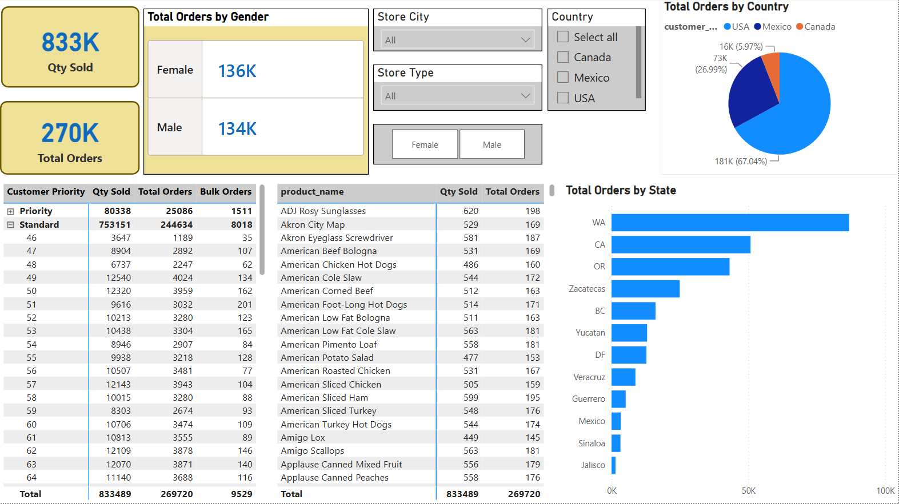

# 👥 Customer Lookup Dashboard — Power BI

An interactive customer analysis dashboard built in **Power BI**  
using a retail dataset covering customer priority, product performance, and regional sales.

---

## 📊 Dashboard Overview

| Visual | Description |
|---|---|
| **Customer Priority Matrix** | Segments customers by Priority & Standard with Qty Sold, Total Orders & Bulk Orders |
| **Total Orders by Gender** | Compares Female vs Male order volumes |
| **Total Orders by Country** | Pie chart showing USA, Mexico & Canada distribution |
| **Total Orders by State** | Bar chart of top performing states |
| **Product Performance Table** | Product-level Qty Sold & Total Orders |
| **Store City & Type Filters** | Interactive slicers for deeper filtering |

---

## 🖼️ Screenshot

---

## 🛠️ Tools & Skills Used

- **Power BI Desktop**
- **DAX** — Measures & Calculations
- **Data Modeling** — Customer, Product & Sales tables
- **Visualizations** — Matrix, Pie Chart, Bar Chart, KPI Cards, Slicers
- **Interactive Filters** — Store City, Store Type, Gender, Country

---

## 🎓 About

- 📚 Built during **DigiSkills Power BI Course**
- 🎓 Student at **Virtual University of Pakistan**
- 📍 Karachi, Pakistan

---

## 📫 Connect with Me

- 💼 [LinkedIn](www.linkedin.com/in/ushnanaeem)
- 🐙 [GitHub](https://github.com/Ushna-hub)
